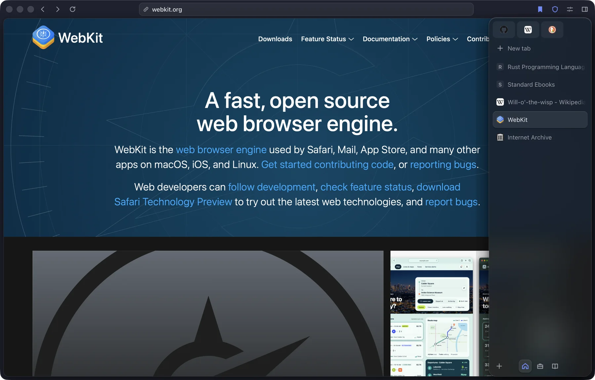
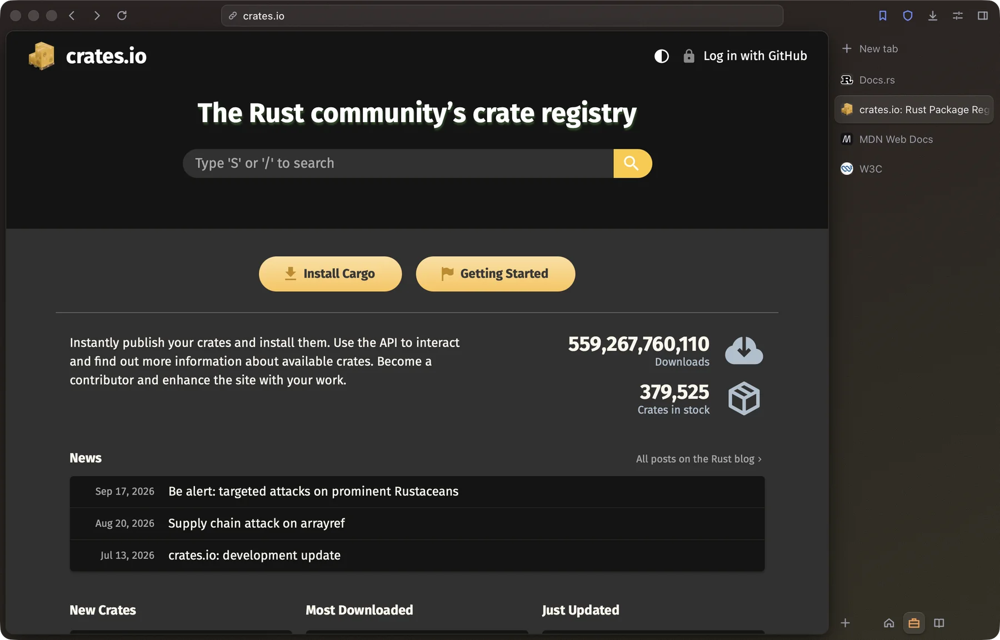
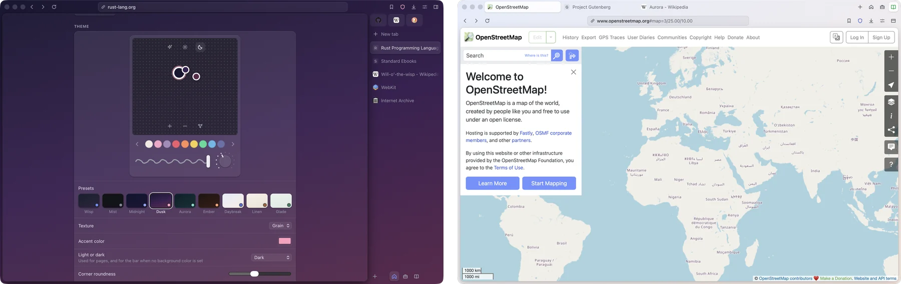
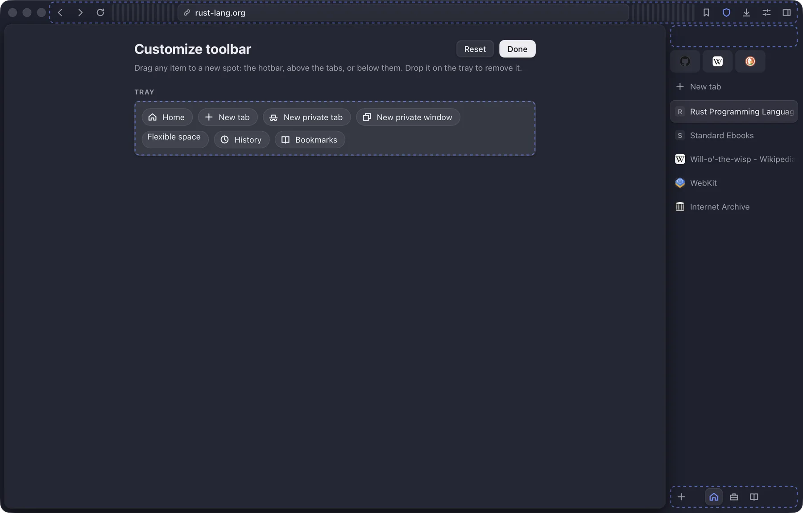
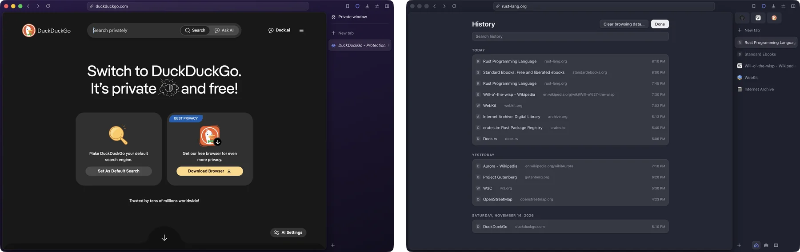

<picture>
  <source media="(prefers-color-scheme: dark)" srcset="docs/images/banner-dark.svg">
  <source media="(prefers-color-scheme: light)" srcset="docs/images/banner-light.svg">
  
</picture>

<p align="center">
  <b>A small, quiet web browser for macOS and Windows that you can make your own.</b>
</p>

<p align="center">
  <a href="https://github.com/Siimas/wisp-browser/releases/latest"><picture><source media="(prefers-color-scheme: dark)" srcset="docs/images/download-macos-dark.svg"></picture></a>
  &nbsp;
  <a href="https://github.com/Siimas/wisp-browser/releases/latest"><picture><source media="(prefers-color-scheme: dark)" srcset="docs/images/download-windows-dark.svg"></picture></a>
</p>

<p align="center">
  <a href="#install">Install</a> ·
  <a href="PRIVACY.md">Privacy</a> ·
  <a href="CHANGELOG.md">What's new</a> ·
  <a href="CONTRIBUTING.md">Contribute</a>
</p>

<picture>
  <source media="(prefers-color-scheme: dark)" srcset="docs/images/hero-dark.webp">
  <source media="(prefers-color-scheme: light)" srcset="docs/images/hero-light.webp">
  
</picture>

Wisp does not ship its own copy of a web engine. It uses the one your computer
already has (WebKit on macOS, WebView2 on Windows), so the download is about
two megabytes and engine security fixes arrive with your system updates. No
account, no telemetry, free and open source.

## A sidebar that gets out of the way

Tabs live in a sidebar on the right or the left, with the ones you keep pinned
as small tiles at the top. Collapse it and the page takes the whole window;
move the mouse to the edge and the sidebar floats back over the page. If you
prefer tabs across the top, there is a classic top bar in two sizes.



## Workspaces

Group tabs into named workspaces, each with its own icon and color. The window
takes a tint of the one you are in, so you can tell at a glance where you are.



## Your colors

The theme editor is a color wheel laid flat. Place up to three colors for a
gradient, set the grain, pick an accent, or start from one of nine presets. Light and dark
are both there, and everything applies as you change it.



## Your toolbar

Drag the address bar, any button, or the workspace switcher to where you want
it: across the top, above the tabs, or below them. Remove what you do not use.
Every keyboard shortcut can be changed too.



## Private by design

- **Nothing phones home.** No telemetry, no analytics, no account, no Wisp
  server. The app itself only asks GitHub whether there is an update (you can
  turn that off), fetches its ad-blocking lists from their publishers, and
  asks the sites in your tabs for their icons.
- **Ads and trackers are blocked** with EasyList and EasyPrivacy, the lists
  most ad blockers use (more in Settings), and the empty slots ads leave are
  hidden. On macOS this happens inside the web engine itself. The shield
  button turns blocking off for a site that breaks under it.
- **Private tabs and private windows** keep nothing on disk.
- **History and bookmarks stay on your computer.** Address bar suggestions come
  only from your own tabs, bookmarks and history. Nothing is sent while you
  type.



Every request Wisp makes, and every file it keeps, is listed in
[PRIVACY.md](PRIVACY.md).

## And the everyday things

Find in page, a downloads list, history, bookmarks, address bar suggestions,
and your tabs back where you left them when you reopen the app. Restored tabs
load only when you open them.

## Install

Get the installer for your system from the
[latest release](https://github.com/Siimas/wisp-browser/releases/latest).

| System | File |
| --- | --- |
| macOS, Apple Silicon | `Wisp-<version>-macOS-Apple-Silicon.dmg` |
| macOS, Intel | `Wisp-<version>-macOS-Intel.dmg` |
| Windows 10 or 11, 64-bit | `Wisp-<version>-Windows-x64-Setup.exe` |

The installers are not code-signed yet, so the first launch needs one extra
step:

- **macOS**: drag Wisp to Applications, run this in Terminal, then open it.

  ```bash
  xattr -cr /Applications/Wisp.app
  ```

- **Windows**: on the SmartScreen prompt choose **More info**, then
  **Run anyway**. If Microsoft Defender ever reports Wisp as a threat, see
  [Wisp and Windows antivirus](docs/WINDOWS-SECURITY.md); please don't turn
  protection off.

Installed copies update themselves: a new version downloads in
the background and is in place the next time you open Wisp. Every update file
is signed, and Wisp refuses one whose signature does not match. You can turn
this off in Settings > About and updates.

<details>
<summary><b>Keyboard shortcuts</b></summary>

<br>

`Mod` is `Cmd` on macOS and `Ctrl` on Windows. All of them can be changed in
Settings > Shortcuts.

| Action | Keys |
| --- | --- |
| New tab / close tab | `Mod+T` / `Mod+W` |
| Reopen closed tab | `Mod+Shift+T` |
| New private tab / private window | `Mod+Shift+P` / `Mod+Shift+N` |
| Next / previous tab | `Ctrl+Tab` / `Ctrl+Shift+Tab` |
| Next / previous workspace | `Mod+Alt+Right` / `Mod+Alt+Left` |
| Collapse or show the bar | `Mod+Shift+B` |
| Focus address bar | `Mod+L` |
| Back / forward | `Mod+[` / `Mod+]` |
| Reload / home | `Mod+R` / `Mod+Shift+H` |
| Zoom in / out / reset | `Mod+=` / `Mod+-` / `Mod+0` |
| Find in page | `Mod+F` |
| History / bookmarks | `Mod+Y` / `Mod+Shift+O` |
| Bookmark this page | `Mod+D` |
| Settings | `Mod+,` |

</details>

<details>
<summary><b>Where Wisp keeps your data</b></summary>

<br>

| | macOS | Windows |
| --- | --- | --- |
| Settings, session, history, bookmarks | `~/Library/Application Support/Wisp/` | `%APPDATA%\Wisp\` |
| Cookies, cache, site storage | `~/Library/WebKit/io.github.siimas.wisp/`, `~/Library/Caches/io.github.siimas.wisp/`, `~/Library/HTTPStorages/io.github.siimas.wisp*` | `wisp.exe.WebView2\` in the install folder (`%LOCALAPPDATA%\Wisp\` unless you chose another) |

Settings are in `config.json`, which the settings page writes for you. Wisp
keeps nothing anywhere else.

</details>

### Uninstall

**macOS**: quit Wisp and drag `Wisp.app` from Applications to the Trash. Your
data stays. To remove it as well:

```bash
rm -rf ~/Library/"Application Support"/Wisp ~/Library/WebKit/io.github.siimas.wisp ~/Library/Caches/io.github.siimas.wisp ~/Library/HTTPStorages/io.github.siimas.wisp*
```

**Windows**: open Settings > Apps > Installed apps, find Wisp and choose
**Uninstall**. Tick **Delete the application data** in the uninstaller to
remove your data too.

## Not built yet

Wisp is young. Things you may miss today:

- Extensions, sync, and importing from another browser.
- Bookmark folders. Bookmarks are one flat list.
- On Windows, empty ad slots are not hidden (ads and trackers are still
  blocked).
- Separate logins per workspace. Workspaces group tabs but share cookies.
- Linux builds.
- On Windows, the page card has square corners and the floating sidebar is
  solid rather than frosted.
- A menu or suggestion list that has to overlap the page hides the page while
  it is open, and a private window shows its own Dock or taskbar icon.

## For developers

Wisp is a thin Rust shell around the system web view, and the whole interface
is one HTML file. You need [Rust](https://rustup.rs); on Windows also the
[WebView2 runtime](https://developer.microsoft.com/microsoft-edge/webview2/),
which Windows 11 already has.

```bash
cargo run --release
```

- [CONTRIBUTING.md](CONTRIBUTING.md): building, checks, pull requests, releases
- [docs/DESIGN.md](docs/DESIGN.md): the design and motion system
- [PRIVACY.md](PRIVACY.md): what the app sends and stores
- [SECURITY.md](SECURITY.md): reporting a vulnerability
- [CHANGELOG.md](CHANGELOG.md): what changed in each version

## License

[MIT](LICENSE). Wisp is built from open-source Rust crates; their licenses are
in [THIRD-PARTY-NOTICES](THIRD-PARTY-NOTICES), also reachable from Settings >
About and updates.
